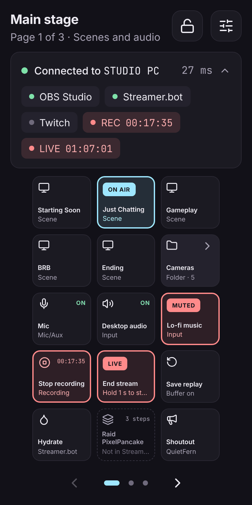
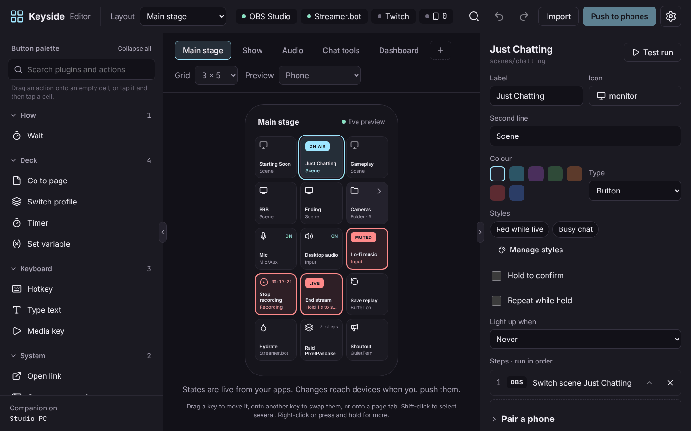

<p align="center">
  
</p>

<h1 align="center">Keyside</h1>

<p align="center">
  Turn a phone, tablet or browser into a stream deck.<br />
  Free, open source, and private by design.<br />
  <a href="https://keyside.sinist3r.lol">keyside.sinist3r.lol</a>
</p>

<p align="center">
  <a href="https://github.com/AmeliaFromFinance/keyside/actions/workflows/ci.yml"></a>
  <a href="LICENSE"></a>
</p>

<p align="center">
  
  &nbsp;
  
</p>

## What it is

Keyside runs a small app on your PC (the **companion**) and shows your keys on any phone, tablet or browser on the same network. Press a key and the PC switches the OBS scene, mutes your mic, runs a Streamer.bot action, plays a sound or types a hotkey.

Keys show live state: the scene that's on air, which inputs are muted, how long you've been recording.

## Highlights

- **Works on what you have.** Android, iOS, tablets, or a browser. Plugged-in Elgato Stream Decks work too.
- **Live keys.** Plugins update keys as things change in your apps.
- **Fits any screen.** Layouts adapt to portrait, landscape, tablet and desktop. Arrange any screen by hand if you like.
- **Stream Deck plugins.** Install `.streamDeckPlugin` files made for Elgato's app and use them on your phone.
- **Secure pairing.** Scan a QR code, confirm a 6-digit code on both screens, done. Everything after that is end-to-end encrypted.
- **Sandboxed plugins.** Plugins can only reach the hosts you allow. They can't read your files or start programs.
- **Multi-actions with if and otherwise, toggles, folders, sliders, timers, chat widgets, variables, hold-to-confirm and repeat while held.**
- **Moderator access.** Give a mod a phone that only sees the pages you pick.
- **Share layouts** as a code or file. Imported steps that control apps stay off until you approve them.
- **HTTP API** so other tools can press keys, set variables and restyle keys.
- **No account, no cloud, no telemetry.**

## Plugins included

| App | What you get |
| --- | --- |
| OBS Studio | Scenes (with live thumbnails), mute, volume, record and pause, chapters, split files, stream, replay buffer, virtual camera, studio mode, transitions, sources, filters, audio monitoring, media, text, screenshots, stream health, scene collections, profiles, hotkeys |
| Streamlabs Desktop | Scenes, mute, volume, record, stream, replay buffer |
| Streamer.bot | Run actions and custom triggers, globals as variables, chat and alerts |
| Twitch | Chat and alerts, markers, clips, ads, chat modes, title and category, shoutouts, raids, polls, predictions, channel point rewards, shield mode |
| YouTube Live | Chat, Super Chats, members, viewer count, send messages |
| VTube Studio | Hotkeys, expressions, model switching, items, sliders that move model parameters |
| VNyan, Warudo | Trigger node graphs and blueprints |
| veadotube | Avatar states with thumbnails |
| Discord | Mute, deafen, push to talk, noise suppression, echo cancellation, voice channels, mic and speaker volume. Equibop on Linux too |
| Spotify | Now playing with album art, playback, volume, like, playlists |
| GoXLR | Fader and cough mutes, channel volumes, voice effects and presets, samples, routing, profiles (through the GoXLR Utility) |
| Voicemeeter | Mute, gain, routing, macro buttons, presets, the recorder and scripts over VBAN |
| Elgato Key Light | Power, brightness, colour temperature, presets |
| Philips Hue | Rooms, zones, lights, scenes, brightness, colour |
| Home Assistant | Toggle devices, scenes, scripts, light brightness and colour, thermostats, media players with covers, camera snapshots, any service, live sensor values |

Built in: hotkeys, typing text, media keys, now playing with cover art (Linux and Windows), open links and apps, sounds, timers, variables, webhooks, WebSocket, OSC, UDP and MIDI.

On Linux and Windows, keys can also mute an app or set its volume. Linux needs `pactl`, which comes with PipeWire and PulseAudio.

Setup for each plugin is in [docs/plugins.md](docs/plugins.md).

## Get started

1. **Install Keyside on your PC** from the [releases page](https://github.com/AmeliaFromFinance/keyside/releases). It starts in the tray and opens the editor.
2. **Pair your phone.** In the editor, choose *Pair a phone* and scan the QR code. Check the 6-digit code matches on both screens, then approve.
3. **Build your deck.** Drag actions onto keys and press *Push to phones*.

The phone app (Android, iOS) and any modern browser work the same way. In a browser, accept the PC's certificate once when asked; the editor shows its fingerprint so you can check it.

Away from home? See [remote access](docs/remote-access.md).

### Phone can't connect?

- Both need to be on the same network. Guest Wi-Fi often keeps devices apart.
- The PC's firewall must allow TCP port 7443:

| System | Command or setting |
| --- | --- |
| Windows | Allow Keyside when Windows asks, and set your network to *Private* |
| macOS | *System Settings → Network → Firewall → Options*: allow Keyside |
| Ubuntu, Mint (ufw) | `sudo ufw allow 7443/tcp` |
| Fedora, openSUSE (firewalld) | `sudo firewall-cmd --permanent --add-port=7443/tcp && sudo firewall-cmd --reload` |

To test, open `https://<PC address>:7443` in the phone's browser. A certificate warning means the network is fine.

## Build from source

You need Rust 1.88+, Node.js 22+ and pnpm 10.

```sh
pnpm install
pnpm build                # plugins and the web app
cargo run -- --plugins plugins
```

Then run `cargo run -- open` to sign in to the editor. Plugins need [Deno](https://deno.com) on your PATH (the desktop app ships its own).

On Linux, install `libudev-dev libasound2-dev libxdo-dev libdbus-1-dev` first.

| Command | Does |
| --- | --- |
| `pnpm test` | All tests |
| `pnpm test:js` | Protocol, SDK, plugins and translations |
| `pnpm test:e2e` | Real companion: pairing, sandbox and Stream Deck plugins |
| `pnpm --filter @keyside/desktop build` | Desktop app (see the release workflow for the Deno sidecar) |
| `pnpm --filter @keyside/mobile android` | Open the Android project |

## Documentation

- [Plugin setup](docs/plugins.md)
- [Writing plugins](docs/plugin-guide.md)
- [Stream Deck plugins](docs/stream-deck-plugins.md)
- [HTTP API](docs/inbound-api.md)
- [Remote access](docs/remote-access.md)
- [Protocol](docs/protocol.md)
- [Privacy](PRIVACY.md) and [security](SECURITY.md)
- [Contributing](CONTRIBUTING.md)

## Project layout

```
crates/companion   The PC side (Rust): server, pairing, actions, plugin host
apps/client        Deck and editor (Svelte), served by the companion
apps/desktop       Desktop app (Tauri): tray, editor window
apps/mobile        Android and iOS app (Capacitor)
packages/protocol  Encrypted channel and shared types
packages/sdk       Plugin SDK
plugins            Bundled plugins
```

## License

The app is [GPL-3.0](LICENSE). The plugin SDK, protocol package and plugin template are [MIT](packages/sdk/LICENSE), so plugins can use any license.

Keyside isn't affiliated with Elgato, OBS or any other app it works with. Product names belong to their owners.
